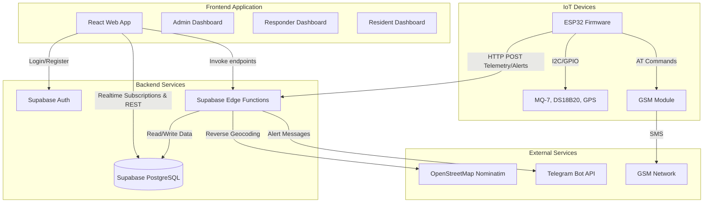
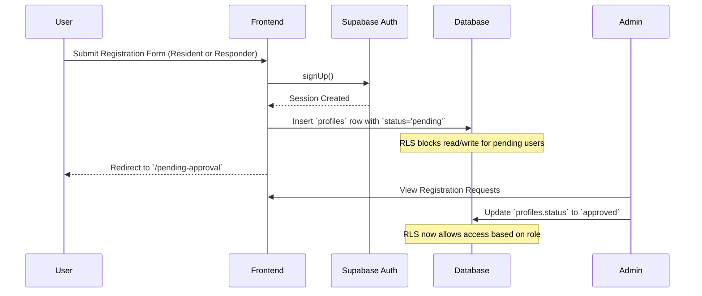
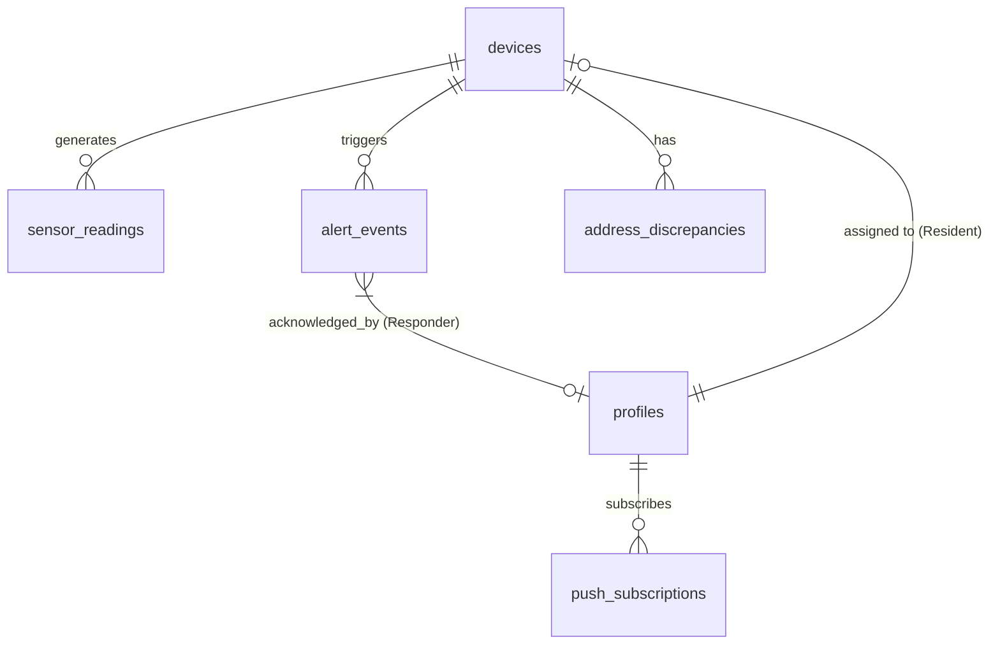
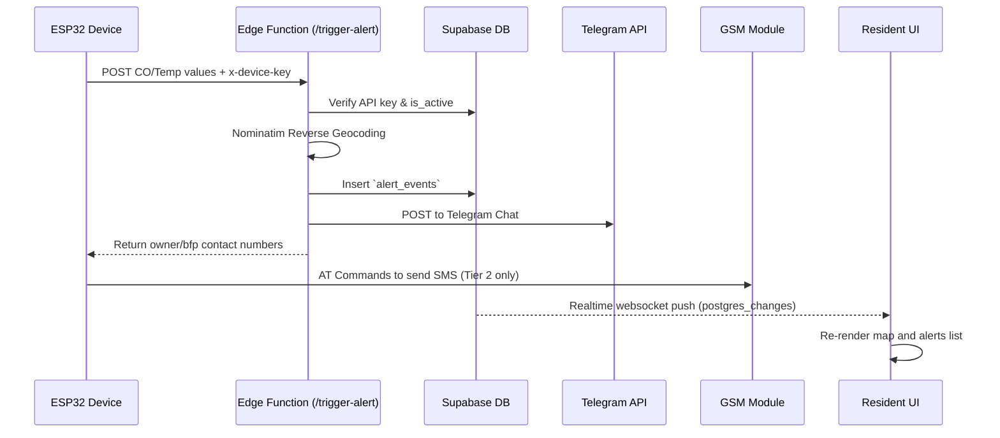

# AgapSense System Specification Document

## Section 1 — Document Overview
- **Document Title:** AgapSense System Specification Document
- **System Name:** AgapSense (IoT-Based Fire Detection and Location Tracking System)
- **Purpose and Scope:** To provide a comprehensive, evidence-based technical reference of the AgapSense repository, covering the web frontend, backend database, edge functions, and IoT firmware.
- **Intended Audience:** Developers, evaluators, and stakeholders reviewing the capstone project implementation.
- **Version / Date:** Document generated based on static code analysis on the current branch.
- **Source-code Baseline:** Branch: `main`, Commit: `df2cfe4ba4d1ec960cd528e8d1238e1212f08275`.
- **Documentation Methodology:** Read-only inspection of source code, configurations, database migrations, and firmware logic.
- **Status Definitions:**
  - **Verified:** Directly supported by the implementation.
  - **Partially Verified:** Some aspects are supported, but important behavior or dependencies remain uncertain.
  - **Unverified:** The available repository evidence is insufficient to establish the behavior.
  - **Not Implemented:** The relevant implementation is absent from the inspected scope.

*Note: This specification describes the current codebase and is not automatically a statement of the system's intended future behavior.*

## Section 2 — System Overview
- **System Purpose:** Provide real-time fire alerts and location tracking for residential areas using dual-path communication (Wi-Fi/GSM) and multi-sensor fusion (CO/Temp).
- **Major Subsystems:**
  - **Web Application:** React-based frontend providing Admin, Responder, and Resident dashboards.
  - **Backend & Database:** Supabase providing PostgreSQL database, Auth, Realtime, and Edge Functions.
  - **IoT Devices:** ESP32 hardware reading DS18B20 (Temperature) and MQ-7 (Carbon Monoxide) sensors.
- **Architecture Diagram:**

## Section 3 — Technology Stack and Repository Structure
- **Frontend:** React 19 (`src/`), TypeScript, Vite, TailwindCSS v4, React Router v7, React Leaflet v5 (for mapping).
- **Backend:** Supabase (PostgreSQL 15+), Edge Functions in Deno (`supabase/functions/`).
- **IoT Firmware:** PlatformIO, C++ (`firmware/agapsense-firmware/`), FreeRTOS.
- **Key Directories:**
  - `src/`: React application (components, pages, contexts).
  - `supabase/migrations/`: Database schema definitions.
  - `supabase/functions/`: Serverless Edge Functions.
  - `firmware/agapsense-firmware/`: ESP32 source code.
  - `docs/`: Markdown documentation.

## Section 4 — User Roles and Permissions
| Role | Responsibilities & Access | Verified RLS Restrictions |
|---|---|---|
| **Admin** | Full system management. Can view all dashboards, users, devices, and map. | `admin` role has unrestricted RLS on most tables via `get_auth_role() IN ('admin')`. Allowed. |
| **BFP Responder** | Incident response. Can view active alerts, update `incident_status`, and view maps. | Read access to alerts/devices. Update access to specific `alert_events` columns (`incident_status`, `acknowledged_by`, etc.) via policy (`20261012000001_responder_incident_status.sql`). Allowed. |
| **Resident** | Monitors personal property. Can view linked device telemetry and configure thresholds. | Strictly limited via RLS to their own `device_id` and own profile. Allowed. |

## Section 5 — Authentication and Account Lifecycle

### Registration & Approval Workflow

### Authentication Lifecycle
- **Registration:** Handled in `src/pages/RegisterResident.tsx` and `src/pages/RegisterResponder.tsx`. Creates a `profiles` entry linking to `auth.users(id)`.
- **Login and Logout:** Handled in `src/pages/Login.tsx` and `src/contexts/AuthContext.tsx`. Session persistence is managed by `@supabase/supabase-js`.
- **Role Assignment:** Enforced strictly via PostgreSQL CHECK constraints on `profiles.role` and accessed via the database function `get_auth_role()`.
- **Protected Routes:** `src/components/AuthGuard.tsx` checks `profile.status` and `profile.role` to redirect users attempting unauthorized access.
- **Login Lockout:** The system tracks failed attempts in `login_attempts`. Enforced via a trigger/RPC combination in migrations `20260924080000` and `20260924090000`.

## Section 6 — Functional Specifications by Module

### A. Admin Dashboard
1. **Module Name and Purpose:** Admin Dashboard (`/dashboard`). Overview of system metrics.
2. **Intended Roles:** Admin.
3. **Entry Route:** `src/pages/Dashboard.tsx`.
4. **Main UI Components:** Stat cards, map preview, recent alerts feed.
5. **User Actions:** View aggregate metrics.
6. **Business Rules:** Shows counts of total users, offline devices, active alerts, and 24h fire events.
7. **Input Validation:** None.
8. **Data Sources:** `devices`, `alert_events`, `profiles`, `sensor_readings`.
9. **Backend Functions:** Uses Realtime subscriptions for live updates.
10. **Success/Failure Behavior:** Displays skeletons while loading.
11. **Permissions:** Admin only.
12. **Source File References:** `src/pages/Dashboard.tsx`.
13. **Implementation Status:** Verified.

### B. BFP Responder Dashboard
1. **Module Name and Purpose:** Responder Dashboard (`/responder`). Monitors live alerts and manages incident status.
2. **Intended Roles:** BFP Responder.
3. **Entry Route:** `src/pages/ResponderDashboard.tsx`.
4. **Main UI Components:** Feed of unresolved alerts, interactive map.
5. **User Actions:** Acknowledge alerts, change incident status (e.g. false alarm).
6. **Business Rules:** Unresolved alerts (where `resolved_at` is null) are displayed. Responders can take ownership.
7. **Input Validation:** Handled by RLS.
8. **Data Sources:** `devices`, `alert_events`, `sensor_readings`.
9. **Backend Functions:** Updates `alert_events.incident_status` directly.
10. **Success/Failure Behavior:** Live UI updates via Supabase Channels.
11. **Permissions:** BFP Responder only.
12. **Source File References:** `src/pages/ResponderDashboard.tsx`.
13. **Implementation Status:** Verified.

### C. Resident Dashboard
1. **Module Name and Purpose:** Resident Home (`/home`). Real-time device telemetry.
2. **Intended Roles:** Resident.
3. **Entry Route:** `src/pages/ResidentHome.tsx`.
4. **Main UI Components:** Live sensor cards (CO, Temp), active alerts list.
5. **User Actions:** Link a device, refresh data, approve/reject address discrepancies.
6. **Business Rules:** Can only view data where `device_id` matches their own profile's `device_id`.
7. **Input Validation:** Device linking requires correct device code.
8. **Data Sources:** `devices_safe` view, `sensor_readings`, `alert_events`.
9. **Backend Functions:** `link-device` edge function.
10. **Success/Failure Behavior:** Show connection lost if device hasn't pinged in >5 minutes.
11. **Permissions:** Resident only.
12. **Source File References:** `src/pages/ResidentHome.tsx`.
13. **Implementation Status:** Verified.

## Section 7 — Business Logic and System Rules

**Rule 1: Tier 1 Alert Generation**
- **Rule Identifier:** RULE-T1-ALERT
- **Trigger:** New sensor reading ingested via `/trigger-alert` Edge Function.
- **Inputs:** `co_ppm`, `temp_celsius`.
- **Processing Logic:** If *either* CO OR Temperature exceeds threshold (but not both), `alert_tier` is 1. (Handled via firmware logic `isTier1()`).
- **Result:** Triggers yellow LED, sends Telegram warning. Does NOT send SMS.
- **Relevant Database Records:** Inserts into `alert_events`.
- **Source File:** `firmware/agapsense-firmware/src/connectivity.cpp`, `supabase/functions/trigger-alert/index.ts`.
- **Verification Status:** Verified.

**Rule 2: Tier 2 Alert Generation**
- **Rule Identifier:** RULE-T2-ALERT
- **Trigger:** New sensor reading ingested via `/trigger-alert` Edge Function.
- **Inputs:** `co_ppm`, `temp_celsius`.
- **Processing Logic:** If *both* CO AND Temperature exceed thresholds, `alert_tier` is 2. (Handled via firmware logic `isTier2()`).
- **Result:** Triggers red LED + buzzer, sends Telegram, and firmware dispatches SMS to owner and BFP.
- **Relevant Database Records:** Inserts into `alert_events` with `alert_tier=2`.
- **Source File:** `firmware/agapsense-firmware/src/connectivity.cpp`, `supabase/functions/trigger-alert/index.ts`.
- **Verification Status:** Verified.

**Rule 3: Address Discrepancy Detection**
- **Rule Identifier:** RULE-ADDR-DRIFT
- **Trigger:** Device sends new coordinates to `/ingest-reading`.
- **Inputs:** `latitude`, `longitude`.
- **Processing Logic:** Haversine distance is calculated between incoming coordinates and device's registered `latitude`/`longitude`.
- **Result:** If distance > 100 meters, a new `address_discrepancies` row is created, alerting the resident.
- **Relevant Database Records:** `address_discrepancies`.
- **Source File:** `supabase/functions/ingest-reading/index.ts`.
- **Verification Status:** Verified.

**Rule 4: Resident Threshold Updates**
- **Rule Identifier:** RULE-RES-THRESH
- **Trigger:** Resident attempts to change threshold sliders.
- **Inputs:** `p_temp_threshold`, `p_co_threshold`.
- **Processing Logic:** Enforced via `update_own_device_alert_settings()` RPC to securely map to their `device_id` without granting table-level UPDATE privileges.
- **Result:** Updates `devices.temp_threshold` and `devices.co_threshold`.
- **Relevant Database Records:** `devices`.
- **Source File:** `supabase/migrations/20260917080000_resident_alert_threshold_rpc.sql`.
- **Verification Status:** Verified.

## Section 8 — IoT Device and Sensor Data Processing
- **Device Architecture:** ESP32 running FreeRTOS tasks.
- **Data Transmission:** Wi-Fi POST requests to Supabase Edge Functions. GSM module used as secondary for SMS alerts.
- **Sensor Readings:** `MQ-7` for CO (requires a warmup sequence tracked by `sensor_ready` flag). `DS18B20` for temperature.
- **Threshold Processing:** Firmware pulls `co_alert_ppm` and `temp_alert_c` from the backend (`fetchRemoteConfig()`). It evaluates thresholds locally on the device (`evaluateAlerts()`).
- **Alert Conditions:** Uses a debounce counter (`ALERT_DEBOUNCE_COUNT`) to prevent transient spikes from triggering immediate alerts.

## Section 9 — GPS, Geolocation, and Address Processing
- **Sources:** Physical GPS module attached to ESP32. Coordinates are stored in `sensor_readings`.
- **Reverse Geocoding:** The Edge Function calls OpenStreetMap Nominatim: `https://nominatim.openstreetmap.org/reverse?format=json&lat=${lat}&lon=${lon}&zoom=18&addressdetails=1`. Reverse geocoding queries are deduplicated using a 4-decimal-place grid cache (`~11m`) and stationary-device checks before calling Nominatim.
- **Tiered Address Generation:** The backend function explicitly parses `house_number`, `road`, `suburb/village` (treated as barangay), and `city/municipality` to build a tiered location string instead of using the raw `display_name`.
- **Discrepancies:** Handled via the `address_discrepancies` table (Rule RULE-ADDR-DRIFT).

## Section 10 — Notification and Communication Specifications
- **Telegram:** Edge Function `trigger-alert` sends HTTP POST to Telegram Bot API using `TELEGRAM_BOT_TOKEN` and `TELEGRAM_CHAT_ID`. Used for both Tier 1 and Tier 2 alerts. Contains Google Maps navigation links.
- **SMS:** The ESP32 firmware directly drives a GSM module via AT commands (`gsm.cpp`). Triggered only on Tier 2 alerts. Sends messages to the owner (Resident) and BFP Responder numbers returned by the `trigger-alert` edge function response.
- **Push Notifications:** Experimental implementations found in `push_subscriptions` table and Edge Functions, partially integrated into frontend via `navigator.serviceWorker`.

## Section 11 — Database and Data Model

### Entity-Relationship Diagram

### Data Dictionaries

#### `devices`
| Column | Data Type | Constraints or Default | Purpose | Evidence |
|---|---|---|---|---|
| id | UUID | PRIMARY KEY, gen_random_uuid() | Unique ID | `20260717000000_init.sql` |
| device_code | TEXT | UNIQUE NOT NULL | Human readable code | `init.sql` |
| api_key | TEXT | UNIQUE NOT NULL | Auth token | `init.sql` |
| co_threshold | INTEGER | NOT NULL DEFAULT 200 | Alert threshold | `init.sql` |
| temp_threshold | FLOAT | NOT NULL DEFAULT 60.0 | Alert threshold | `init.sql` |

#### `profiles`
| Column | Data Type | Constraints or Default | Purpose | Evidence |
|---|---|---|---|---|
| id | UUID | PRIMARY KEY, FK auth.users | Maps to auth user | `init.sql` |
| role | TEXT | CHECK IN admin, bfp_responder, resident | RBAC | `init.sql` |
| status | TEXT | CHECK IN approved, pending, rejected | Approval status | `init.sql` |
| device_id | UUID | FK devices(id) | Linked device | `init.sql` |

#### `alert_events`
| Column | Data Type | Constraints or Default | Purpose | Evidence |
|---|---|---|---|---|
| id | UUID | PRIMARY KEY | Unique ID | `init.sql` |
| alert_tier | INTEGER | CHECK IN (1, 2) | Severity | `init.sql` |
| incident_status | TEXT | CHECK IN active, acknowledged... | Tracker | `20261012000001_responder_incident_status.sql` |

## Section 12 — API, Edge Functions, and Data Access

**Function: `ingest-reading`**
- **Caller:** ESP32 Firmware (`postTelemetry()`).
- **HTTP Method:** POST.
- **Inputs:** `device_id`, `co_ppm`, `temp_celsius`, `latitude`, `longitude`, `gps_valid`.
- **Validation:** Enforces `x-device-key` header matches `devices.api_key`. Validates finite numbers.
- **Auth Checks:** Uses Supabase Service Role Key (bypasses RLS).
- **DB Operations:** Inserts into `sensor_readings`. Evaluates distance and optionally inserts into `address_discrepancies`.
- **Side Effects:** Resolves open alerts if readings fall below safe thresholds.
- **Source:** `supabase/functions/ingest-reading/index.ts`.

**Function: `trigger-alert`**
- **Caller:** ESP32 Firmware (`postAlert()`).
- **HTTP Method:** POST.
- **Inputs:** `tier`, `co_ppm`, `temp_celsius`, `latitude`, `longitude`, `gps_valid`.
- **Validation:** Validates `x-device-key`. Validates tier is 1 or 2.
- **Auth Checks:** Uses Supabase Service Role Key.
- **DB Operations:** Inserts into `alert_events`.
- **Side Effects:** Reverse Geocodes. Sends Telegram HTTP POST. Returns `owner_contact` and `bfp_contact` to firmware.
- **Source:** `supabase/functions/trigger-alert/index.ts`.

## Section 13 — Real-Time Updates and State Management
- **Supabase Realtime:** The system relies entirely on Supabase Realtime Channels for dashboard state.
  - Channels are created using `supabase.channel('channel_name')`.
  - Subscriptions target `postgres_changes` for `INSERT`, `UPDATE`, and `DELETE` events.
  - The map `InteractiveMap.tsx` and dashboards `ResponderDashboard.tsx`, `Dashboard.tsx`, `ResidentHome.tsx` auto-refresh or append state when PostgreSQL emits changes for `alert_events` or `sensor_readings`.

## Section 14 — External Services and Configuration
- **Supabase:** PostgreSQL backend, Edge Functions runtime.
- **OpenStreetMap Nominatim:** Used for reverse geocoding inside Edge Functions. No API key required, but usage limits apply. A custom identifying `User-Agent` string (`AgapSense-Capstone/1.0 (contact@agapsense.local)`) is used, complying with Nominatim’s acceptable use policy. Geocoding requests are cached to avoid hitting rate limits.
- **Telegram Bot API:** Requires `TELEGRAM_BOT_TOKEN` and `TELEGRAM_CHAT_ID` set in Supabase Secrets. Used by `trigger-alert`.
- **Environment Variables:** `VITE_SUPABASE_URL` and `VITE_SUPABASE_ANON_KEY` are mandatory for the frontend.

## Section 15 — Error Handling, Validation, and Security
- **Input Validation:** Frontend uses standard HTML5 validations. Edge Functions strict-check numeric values (`isValidNumber()`).
- **Security:** Hardware communication is secured via the `x-device-key` header (tied to `devices.api_key`), ensuring only authenticated physical devices can ingest readings.
- **RLS Bypasses:** Some endpoints inherently bypass RLS by using the `service_role` key inside Edge Functions (e.g., to create an alert on behalf of a device).

## Section 16 — Non-Functional Characteristics and Limitations
- **Reliability:** Firmware gracefully degrades functionality. If Wi-Fi fails, alerts can fall back to GSM SMS.
- **Scalability:** Leveraging Supabase Edge Functions allows decoupled processing of telemetry spikes.
- **Limitations:** Dependent on Nominatim's rate limits for reverse geocoding. High frequency bursts could lead to HTTP 429 Too Many Requests. Unverified: Max capacity of simultaneous device WebSocket connections.

## Section 17 — End-to-End System Workflows

### Telemetry & Real-Time Alert Flow

## Section 18 — Requirements Traceability Matrix
| Requirement ID | Feature or Behavior | User Role | Frontend Implementation | Backend Implementation | Verification Status |
|---|---|---|---|---|---|
| AUTH-001 | Approval Gateway | Admin | `PendingApproval.tsx` | RLS policies on `profiles` | Verified |
| DEVICE-001 | Tiered Alert Logic | System | Maps & Dashboard UI | `connectivity.cpp`, `trigger-alert` | Verified |
| GPS-001 | Address Discrepancy | Resident | `ResidentHome.tsx` | `ingest-reading` | Verified |
| RBAC-001 | Role Access Routing | System | `AuthGuard.tsx` | `get_auth_role()` | Verified |
| ALERT-001 | Acknowledge Alert | Responder | `ResponderDashboard.tsx` | `20261012000001` migration | Verified |

## Section 19 — Manual Verification Reference

**Test Case ID: TC-001**
- **Objective:** Verify Resident Approval Workflow.
- **Preconditions:** None.
- **User Role:** Admin / Resident.
- **Steps:**
  1. Register a new resident user.
  2. Attempt to view `/home` (Expect redirect to `/pending-approval`).
  3. Login as Admin, approve user.
  4. Login as Resident, verify access to `/home`.
- **Expected Result:** Access granted only post-approval.
- **Files:** `RegisterResident.tsx`, `PendingApproval.tsx`.
- **Verification Status:** Unverified (requires manual testing).

**Test Case ID: TC-002**
- **Objective:** Verify Tier 2 Alert generation.
- **Preconditions:** Valid device registered.
- **User Role:** System.
- **Steps:**
  1. Send mock HTTP POST to `/trigger-alert` with `x-device-key`, tier 2, CO=400, Temp=80.
  2. Check `alert_events` table for insertion.
  3. Check Telegram for notification.
  4. Verify Interactive Map shows red marker.
- **Expected Result:** Alert cascades through DB, UI, and external services.
- **Files:** `trigger-alert/index.ts`, `InteractiveMap.tsx`.
- **Verification Status:** Unverified (requires manual testing).

## Section 20 — Known Gaps, Ambiguities, and Implementation Discrepancies
- **Push Notifications:** The `push_subscriptions` table and associated Edge Functions exist, but the corresponding frontend Service Worker implementation for Web Push is absent or incomplete.
- **Hardware Dependency:** The repository assumes standard Wi-Fi coverage; however, actual field deployment robustness (GSM failover reliability) remains unverified.
- **RLS Edge Cases:** A few database tables (`settings`, `station_settings`) rely heavily on Admin roles; there is no documented frontend GUI to alter `station_settings`, indicating missing admin UI features.

## Section 21 — Glossary and Reference Index
- **BFP:** Bureau of Fire Protection.
- **RLS:** Row Level Security (PostgreSQL constraint system).
- **RPC:** Remote Procedure Call (Supabase wrapper for PostgreSQL Functions).
- **Tier 1:** Warning Level (Either CO or Temperature threshold breached).
- **Tier 2:** Critical Level (Both CO and Temperature thresholds breached).
- **Nominatim:** Open-source reverse geocoding engine used to map coordinates to textual addresses.
