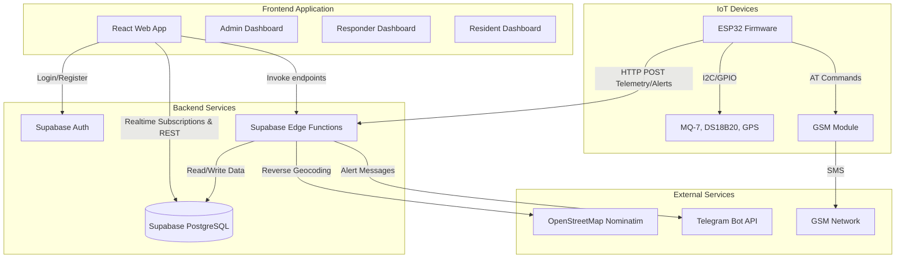
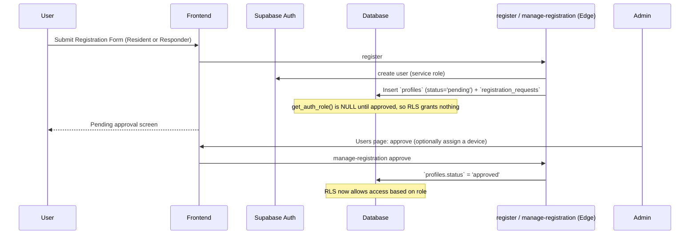
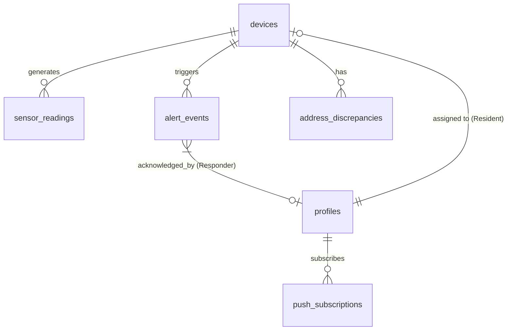
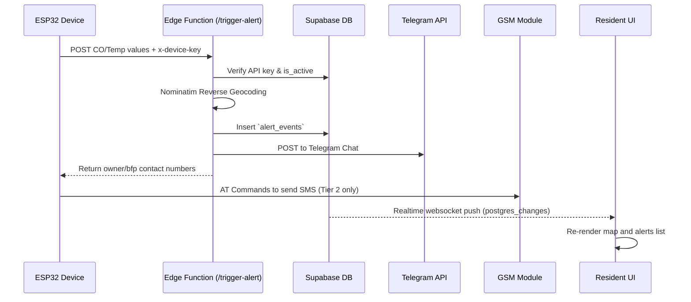

# AgapSense System Specification Document

## Section 1 — Document Overview
- **Document Title:** AgapSense System Specification Document
- **System Name:** AgapSense (IoT-Based Fire Detection and Location Tracking System)
- **Purpose and Scope:** To provide a comprehensive, evidence-based technical reference of the AgapSense repository, covering the web frontend, backend database, edge functions, and IoT firmware.
- **Intended Audience:** Developers, evaluators, and stakeholders reviewing the capstone project implementation.
- **Version / Date:** Updated 2026-10-16 against `main` at `d74dc81` (originally generated at `df2cfe4`, revised 2026-10-13). This is a summary; the detailed, evidence-based reference, including the full Known Issues list, is [`system-specification.md`](system-specification.md) (v0.3 draft).
- **Source-code Baseline:** Branch: `main`, Commit: `d74dc81` (2026-10-16).
- **Documentation Methodology:** Read-only inspection of source code, configurations, database migrations, and firmware logic.
- **Status Definitions:**
  - **Verified:** Directly supported by the implementation.
  - **Partially Verified:** Some aspects are supported, but important behavior or dependencies remain uncertain.
  - **Unverified:** The available repository evidence is insufficient to establish the behavior.
  - **Not Implemented:** The relevant implementation is absent from the inspected scope.

*Note: Sections were revised on 2026-10-13 and again on 2026-10-16 against the current code. Items implemented in the repository but not yet deployed are marked **[repo only]**. This specification describes the current codebase and is not automatically a statement of the system's intended future behavior.*

## Section 2 — System Overview
- **System Purpose:** Provide real-time fire alerts and location tracking for residential areas using dual-path communication (Wi-Fi/GSM) and multi-sensor fusion (CO/Temp).
- **Major Subsystems:**
  - **Web Application:** React-based frontend providing Admin, Responder, and Resident dashboards.
  - **Backend & Database:** Supabase providing PostgreSQL database, Auth, Realtime, and Edge Functions.
  - **IoT Devices:** ESP32 hardware reading DS18B20 (Temperature) and MQ-7 (Carbon Monoxide) sensors.
- **Architecture Diagram:**

## Section 3 — Technology Stack and Repository Structure
- **Frontend:** React 19 (`src/`), TypeScript, Vite, TailwindCSS v4, React Router v7, React Leaflet v5 (for mapping).
- **Backend:** Supabase (PostgreSQL 15+), Edge Functions in Deno (`supabase/functions/`).
- **IoT Firmware:** PlatformIO, C++ (`firmware/agapsense-firmware/`), FreeRTOS.
- **Key Directories:**
  - `src/`: React application (components, pages, contexts).
  - `supabase/migrations/`: Database schema definitions.
  - `supabase/functions/`: Serverless Edge Functions.
  - `firmware/agapsense-firmware/`: ESP32 source code.
  - `docs/`: Markdown documentation.

## Section 4 — User Roles and Permissions
| Role | Responsibilities & Access | Verified RLS Restrictions |
|---|---|---|
| **Admin** | Full system management. Can view all dashboards, users, devices, and map. | `admin` role has unrestricted RLS on most tables via `get_auth_role() IN ('admin')`. Allowed. |
| **BFP Responder** | Incident response for fires (Tier 2). Can view fire alerts and devices, move incidents through their lifecycle, edit station information. | Read access to alerts/devices (no `api_key`). Incident changes only through the `transition_incident()` RPC; direct `UPDATE` on `alert_events` was revoked in `20261022000000`. `FOR ALL` on `station_settings`. |
| **Resident** | Monitors personal property. Can view linked device telemetry and configure thresholds. | Strictly limited via RLS to their own `device_id` and own profile. Allowed. |

## Section 5 — Authentication and Account Lifecycle

### Registration & Approval Workflow

### Authentication Lifecycle
- **Registration:** Handled in `src/pages/auth/RegisterResident.tsx` and `src/pages/auth/RegisterResponder.tsx`, which call the `register` Edge Function (creates the auth user, a `pending` `profiles` row and a `registration_requests` row). Only `resident` and `bfp_responder` can self-register.
- **Login and Logout:** Handled in `src/pages/auth/Login.tsx` (which calls the `login` Edge Function) and `src/contexts/AuthContext.tsx`. Session persistence is managed by `@supabase/supabase-js`. Per-role idle timeout (`useIdleTimeout.ts`, keys `timeout_admin` / `timeout_bfp` / `timeout_resident`) signs the user out and redirects to `/session-expired`. No migration seeds these keys, so the timeout is off until an admin saves Settings (KI-30).
- **Role Assignment:** Enforced strictly via PostgreSQL CHECK constraints on `profiles.role` and accessed via the database function `get_auth_role()`.
- **Protected Routes:** `src/components/AuthGuard.tsx` checks `profile.status`, `profile.is_active` and `profile.role` to redirect users attempting unauthorized access.
- **Login Lockout:** Enforced server-side by the `login` Edge Function using `check_login_lockout` and `login_attempts` (migrations `20260924080000`, `20260924090000`). The e-mail is lower-cased first. Within 15 minutes: 3 failures → 10 s delay, 5 → 30 s, 7 → 900 s lock. An admin can unlock early (`admin_unlock_login`). Direct calls to GoTrue bypass the lockout (accepted risk).
- **Backend approval:** `get_auth_role()` returns NULL unless the profile is `approved` and `is_active` (`20261031000000`, `20261030000000`), so RLS denies pending, rejected and deactivated accounts. Gap: a deactivated user can set its own `is_active` back to true while its access token is still valid (KI-10).
- **Deactivation:** admins deactivate or reactivate users through `manage-user`, which sets `is_active` and bans/unbans the auth user.

## Section 6 — Functional Specifications by Module

### A. Admin Dashboard
1. **Module Name and Purpose:** Admin Dashboard (`/dashboard`). Overview of system metrics.
2. **Intended Roles:** Admin.
3. **Entry Route:** `src/pages/admin/Dashboard.tsx`.
4. **Main UI Components:** Stat cards, map preview, recent alerts feed.
5. **User Actions:** View aggregate metrics; related admin pages are Live Map, Device Status (`DeviceStatus.tsx`: fleet status, manual resolve via `transition_incident`), Devices (register with generated `AGS-NNN` codes, confirm install pins, OTA target), Users (approve, edit, deactivate), System Log, Support Requests and Settings.
6. **Business Rules:** Shows device connectivity (Online < 2 min, Reconnecting 2–15 min, Offline > 15 min via `src/lib/deviceStatus.ts`), active alerts, user count, recent readings and a battery badge when the device reports `on_battery`.
7. **Input Validation:** None.
8. **Data Sources:** `devices`, `alert_events`, `profiles`, `sensor_readings`.
9. **Backend Functions:** Uses Realtime subscriptions for live updates.
10. **Success/Failure Behavior:** Displays skeletons while loading.
11. **Permissions:** Admin only.
12. **Source File References:** `src/pages/admin/Dashboard.tsx`.
13. **Implementation Status:** Verified.

### B. BFP Responder Dashboard
1. **Module Name and Purpose:** Responder Dashboard (`/responder`). Monitors live alerts and manages incident status.
2. **Intended Roles:** BFP Responder.
3. **Entry Route:** `src/pages/responder/ResponderDashboard.tsx` (also `ResponderAlertLogs.tsx`, `ResponderSettings.tsx`).
4. **Main UI Components:** Summary cards, feed of open fire (Tier 2) alerts with the linked resident's contact, device map, alarm sound.
5. **User Actions:** Acknowledge, mark responding, resolve or mark false alarm (with confirmation on close); edit own profile, Telegram link, browser notifications and station information; send a support request.
6. **Business Rules:** Only Tier 2 incidents are shown; Tier 1 warnings go to admins. Lifecycle is `active → acknowledged → responding → resolved | false_alarm`; closed incidents are immutable.
7. **Input Validation:** Enforced inside `transition_incident()` (approved + active checked).
8. **Data Sources:** `devices`, `alert_events`, `sensor_readings`.
9. **Backend Functions:** `transition_incident()` RPC (client helper `src/lib/incidents.ts`, migration `20261021000000`); `get_incident_resident_contact()` (`20261104000000`). Direct column UPDATE on `alert_events` is revoked by `20261022000000`.
10. **Success/Failure Behavior:** Live UI updates via Supabase Channels.
11. **Permissions:** BFP Responder only.
12. **Source File References:** `src/pages/responder/ResponderDashboard.tsx`.
13. **Implementation Status:** Verified.

### C. Resident Dashboard
1. **Module Name and Purpose:** Resident Home (`/home`). Real-time device telemetry.
2. **Intended Roles:** Resident.
3. **Entry Route:** `src/pages/resident/ResidentHome.tsx` (also `ResidentSetup`, `ResidentAlertSettings`, `ResidentDeviceInfo`, `ResidentAlerts`, `ResidentAccount`).
4. **Main UI Components:** Status panel, readings (CO shows "Warming up" while `sensor_ready` is false) with a 24-reading chart, recent alerts, emergency contacts, notification status, device health (power: Mains / On battery), install location.
5. **User Actions:** Complete mandatory first-login setup (mobile number, then install address and pin if a device is linked), link a device by its code, edit thresholds and contact number, enable Web Push / Telegram link, approve/reject address discrepancies.
6. **Business Rules:** Can only view data where `device_id` matches their own profile's `device_id`.
7. **Input Validation:** Device linking requires correct device code.
8. **Data Sources:** `devices_safe` view, `sensor_readings`, `alert_events`.
9. **Backend Functions:** `link-device` edge function.
10. **Success/Failure Behavior:** Connectivity uses the shared 2 min / 15 min Online / Reconnecting / Offline helper.
11. **Permissions:** Resident only.
12. **Source File References:** `src/pages/resident/ResidentHome.tsx`.
13. **Implementation Status:** Verified.

## Section 7 — Business Logic and System Rules

**Rule 1: Tier 1 Alert Generation**
- **Rule Identifier:** RULE-T1-ALERT
- **Trigger:** New sensor reading ingested via `/trigger-alert` Edge Function.
- **Inputs:** `co_ppm`, `temp_celsius`.
- **Processing Logic:** If *either* CO OR Temperature is at or above its threshold (but not both), `alert_tier` is 1. If neither is, the request is rejected (HTTP 400 `below_threshold`). The Edge Function recalculates and overrides the firmware-supplied tier based on database thresholds to ensure backend authority.
- **Result:** Triggers yellow LED; Web Push and linked-Telegram messages to approved, active **admins only**. No station-chat Telegram, nothing to responders or the resident, no SMS.
- **Relevant Database Records:** `alert_events` via `raise_alert()` (one open incident per device; tier only increases; notifications de-duplicated by the `claim_notification` ledger).
- **Source File:** `firmware/agapsense-firmware/src/connectivity.cpp`, `supabase/functions/trigger-alert/index.ts`.
- **Verification Status:** Verified.

**Rule 2: Tier 2 Alert Generation**
- **Rule Identifier:** RULE-T2-ALERT
- **Trigger:** New sensor reading ingested via `/trigger-alert` Edge Function.
- **Inputs:** `co_ppm`, `temp_celsius`.
- **Processing Logic:** If *both* CO AND Temperature exceed thresholds, `alert_tier` is 2. The Edge Function recalculates and overrides the firmware-supplied tier based on database thresholds to ensure backend authority.
- **Result:** Triggers red LED + buzzer, sends Telegram to the station chat and to linked chats, Web Push (admins, responders, linked resident), and firmware dispatches SMS to the owner and to the device's BFP number (5-minute SMS-only debounce).
- **Relevant Database Records:** `alert_events` with `alert_tier=2` (upgrades an open Tier 1 incident).
- **Source File:** `firmware/agapsense-firmware/src/connectivity.cpp`, `supabase/functions/trigger-alert/index.ts`.
- **Verification Status:** Verified.

**Rule 3: Address Discrepancy Detection**
- **Rule Identifier:** RULE-ADDR-DRIFT
- **Trigger:** Device sends new coordinates to `/ingest-reading`.
- **Inputs:** `latitude`, `longitude`.
- **Processing Logic:** Haversine distance is calculated between incoming coordinates and device's registered `latitude`/`longitude`.
- **Result:** If distance > 100 meters, a new `address_discrepancies` row is created, alerting the resident. Approving it overwrites the device's registered address and coordinates.
- **Relevant Database Records:** `address_discrepancies`.
- **Source File:** `supabase/functions/ingest-reading/index.ts`.
- **Verification Status:** Verified.

**Rule 4: Resident Threshold Updates**
- **Rule Identifier:** RULE-RES-THRESH
- **Trigger:** Resident attempts to change threshold sliders.
- **Inputs:** `p_temp_threshold`, `p_co_threshold`.
- **Processing Logic:** Enforced via `update_own_device_alert_settings()` RPC to securely map to their `device_id` without granting table-level UPDATE privileges.
- **Result:** Updates `devices.temp_threshold` and `devices.co_threshold`.
- **Relevant Database Records:** `devices`.
- **Source File:** `supabase/migrations/20260917080000_resident_alert_threshold_rpc.sql`.
- **Verification Status:** Verified.

## Section 8 — IoT Device and Sensor Data Processing
- **Device Architecture:** ESP32 running FreeRTOS tasks.
- **Data Transmission:** Wi-Fi POST requests to Supabase Edge Functions. GSM module used as secondary for SMS alerts.
- **Sensor Readings:** `MQ-7` for CO utilizes an alternating heating cycle (60 s at 5.0 V heating, 90 s at ~1.4 V measuring via PWM 72/255). `sensor_ready` becomes true only after the first complete cycle (~150 s after power-on). Routine telemetry is transmitted every 30 s regardless; alert evaluation is suppressed until `sensor_ready` is true. Backend auto-resolution also requires `sensor_ready`. `DS18B20` provides continuous ambient temperature monitoring.
- **Threshold Processing:** Firmware pulls thresholds and the owner/BFP numbers from `get-device-config` at boot and every 10 minutes (compiled-in defaults if offline at boot). It evaluates thresholds locally; the backend recomputes the tier and is authoritative.
- **Alert Conditions:** 3 consecutive readings (`ALERT_DEBOUNCE_COUNT`) to enter an alert or escalate Tier 1 → 2; 2 consecutive safe readings (`ALERT_RESOLUTION_COUNT`) to clear. Alert POSTs retry with backoff; SMS outcomes are reported via `confirm-sms-status`.
- **Indicators:** yellow LED (Tier 1), red LED + buzzer (Tier 2), blue LED solid when online, blinking when degraded, off when offline.
- **Provisioning and power:** WiFiManager captive portal (WPA2-protected AP `AgapSense-Setup`, which also takes the device ID and API key); `on_battery` flag when battery ADC < 4000 mV; 30 s watchdog; OTA update when the backend firmware target differs. Readings generated offline are not buffered.

## Section 9 — GPS, Geolocation, and Address Processing
- **Sources:** NEO-6M GPS attached to the ESP32. A fix is live only if valid and < 5 s old; otherwise the last good fix is sent with `gps_valid=false` (initial value 0,0 before any fix). Coordinates are stored in `sensor_readings`; the UI labels locations live / last-known / registered / unavailable (`src/lib/location.ts`).
- **Reverse Geocoding:** The Edge Function calls OpenStreetMap Nominatim: `https://nominatim.openstreetmap.org/reverse?format=json&lat=${lat}&lon=${lon}&zoom=18&addressdetails=1`. Reverse geocoding queries are deduplicated using a 4-decimal-place grid cache (`~11m`) and stationary-device checks before calling Nominatim.
- **Tiered Address Generation:** The backend function explicitly parses `house_number`, `road`, `suburb/village` (treated as barangay), and `city/municipality` to build a tiered location string instead of using the raw `display_name`.
- **Discrepancies:** Handled via the `address_discrepancies` table (Rule RULE-ADDR-DRIFT).

## Section 10 — Notification and Communication Specifications
- **Telegram:** Edge Function `trigger-alert` sends HTTP POST to Telegram Bot API using `TELEGRAM_BOT_TOKEN` and `TELEGRAM_CHAT_ID` (one shared station chat). The station chat receives Tier 2 only; each approved, active user who linked Telegram (`telegram-webhook`, stored in `profiles.telegram_chat_id`) receives the alerts their role gets (admins: both tiers; responders and the device's resident: Tier 2). Messages contain `https://maps.google.com/?q=lat,lng`.
- **SMS:** The ESP32 firmware directly drives a GSM module via AT commands (`gsm.cpp`). Triggered only on Tier 2 alerts. Two separate messages: a plain-language evacuation message to the owner (resident) number and a technical message to the device's BFP number (`devices.bfp_contact`), both with a maps link; numbers come from the `trigger-alert` response (and `get-device-config`). SMS only — no data-over-GSM fallback.
- **Push Notifications:** Web Push (VAPID) via `register-push` / `send-push-notification`, service worker `public/sw.js`. Opt-in UI exists for all three roles. Delivery not verified.

## Section 11 — Database and Data Model

### Entity-Relationship Diagram

### Data Dictionaries

#### `devices`
| Column | Data Type | Constraints or Default | Purpose | Evidence |
|---|---|---|---|---|
| id | UUID | PRIMARY KEY, gen_random_uuid() | Unique ID | `20260717000000_init.sql` |
| device_code | TEXT | UNIQUE NOT NULL | Human readable code | `init.sql` |
| api_key | TEXT | UNIQUE NOT NULL | Auth token | `init.sql` |
| co_threshold | INTEGER | NOT NULL DEFAULT 200 | Alert threshold | `init.sql` |
| temp_threshold | FLOAT | NOT NULL DEFAULT 60.0 | Alert threshold | `init.sql` |

#### `profiles`
| Column | Data Type | Constraints or Default | Purpose | Evidence |
|---|---|---|---|---|
| id | UUID | PRIMARY KEY, FK auth.users | Maps to auth user | `init.sql` |
| role | TEXT | CHECK IN admin, bfp_responder, resident | RBAC | `init.sql` |
| status | TEXT | CHECK IN approved, pending, rejected | Approval status | `init.sql` |
| device_id | UUID | FK devices(id) | Linked device | `init.sql` |

#### `alert_events`
| Column | Data Type | Constraints or Default | Purpose | Evidence |
|---|---|---|---|---|
| id | UUID | PRIMARY KEY | Unique ID | `init.sql` |
| alert_tier | INTEGER | CHECK IN (1, 2) | Severity | `init.sql` |
| incident_status | TEXT | CHECK IN active, acknowledged... | Tracker | `20261012000001_responder_incident_status.sql` |

## Section 12 — API, Edge Functions, and Data Access

**Function: `ingest-reading`**
- **Caller:** ESP32 Firmware (`postTelemetry()`).
- **HTTP Method:** POST.
- **Inputs:** `device_id`, `co_ppm`, `temp_celsius`, `latitude`, `longitude`, `gps_valid`.
- **Validation:** Enforces `x-device-key` header matches `devices.api_key`. Validates finite numbers.
- **Auth Checks:** Uses Supabase Service Role Key (bypasses RLS).
- **DB Operations:** Inserts into `sensor_readings`. Evaluates distance and optionally inserts into `address_discrepancies`.
- **Side Effects:** Updates `last_seen_at`; after two consecutive `sensor_ready` readings strictly below both thresholds, closes open incidents still in status `active` (owner decision D6.1; acknowledged/responding ones are left to a responder); creates address-drift prompts.
- **Source:** `supabase/functions/ingest-reading/index.ts`.

**Function: `trigger-alert`**
- **Caller:** ESP32 Firmware (`postAlert()`).
- **HTTP Method:** POST.
- **Inputs:** `tier` (ignored — recomputed), `co_ppm`, `temp_celsius`, `latitude`, `longitude`, `gps_valid`.
- **Validation:** Validates `x-device-key`; rejects readings below both thresholds (`below_threshold`).
- **Auth Checks:** Uses Supabase Service Role Key.
- **DB Operations:** `raise_alert()` upsert into `alert_events` (falls back to select-then-insert until the migration is applied); notification ledger claims.
- **Side Effects:** Reverse Geocodes. Sends Telegram HTTP POST and Web Push. Returns `owner_contact`, `bfp_contact` and the alert event id to firmware.

**Other device-facing functions:** `get-device-config` (thresholds, numbers, firmware target) and `confirm-sms-status` (per-SMS delivery outcome). **User/admin-facing:** `login`, `register`, `manage-registration`, `create-user`, `manage-user`, `assign-device`, `link-device`, `telegram-webhook`, `register-push`, `send-push-notification`, `admin-support-request` and `resolve-support-request` (in-app `support_requests` inbox).
- **Source:** `supabase/functions/trigger-alert/index.ts`.

## Section 13 — Real-Time Updates and State Management
- **Supabase Realtime:** The system relies entirely on Supabase Realtime Channels for dashboard state.
  - Channels are created using `supabase.channel('channel_name')`.
  - Subscriptions target `postgres_changes` for `INSERT`, `UPDATE`, and `DELETE` events.
  - The map `InteractiveMap.tsx` and dashboards `ResponderDashboard.tsx`, `Dashboard.tsx`, `ResidentHome.tsx` auto-refresh or append state when PostgreSQL emits changes for `alert_events` or `sensor_readings`.

## Section 14 — External Services and Configuration
- **Supabase:** PostgreSQL backend, Edge Functions runtime.
- **OpenStreetMap Nominatim:** Used for reverse geocoding inside Edge Functions. No API key required, but usage limits apply. A custom identifying `User-Agent` string (`AgapSense-Capstone/1.0 (contact@agapsense.local)`) is used, complying with Nominatim’s acceptable use policy. Geocoding requests are cached to avoid hitting rate limits.
- **Telegram Bot API:** Requires `TELEGRAM_BOT_TOKEN`, `TELEGRAM_CHAT_ID` and `TELEGRAM_WEBHOOK_SECRET` in Supabase Secrets. Used by `trigger-alert`, `telegram-webhook` and the support-request functions.
- **Web Push:** `VAPID_PUBLIC_KEY`, `VAPID_PRIVATE_KEY`, optional `VAPID_SUBJECT`; frontend `VITE_VAPID_PUBLIC_KEY`.
- **Environment Variables:** `VITE_SUPABASE_URL` and `VITE_SUPABASE_ANON_KEY` are mandatory for the frontend. See `docs/MIGRATION_GUIDE.md`.

## Section 15 — Error Handling, Validation, and Security
- **Input Validation:** Frontend uses standard HTML5 validations. Edge Functions strict-check numeric values (`isValidNumber()`).
- **Security:** Every device-facing Edge Function (`ingest-reading`, `trigger-alert`, `get-device-config`, `confirm-sms-status`) requires the `x-device-key` header matching an active device's `api_key`; the ESP32 also pins a root CA for HTTPS. Keys are generated server-side and can be regenerated by an admin.
- **RLS Bypasses:** Some endpoints inherently bypass RLS by using the `service_role` key inside Edge Functions (e.g., to create an alert on behalf of a device).

## Section 16 — Non-Functional Characteristics and Limitations
- **Reliability:** Tier 2 SMS goes through the SIM800L independently of Wi-Fi, so SMS can still be sent when Wi-Fi is down, using the last fetched (or compiled-in default) numbers; the alert POST is retried when connectivity returns. Hardware behaviour is unverified. Readings generated offline are lost.
- **Scalability:** Leveraging Supabase Edge Functions allows decoupled processing of telemetry spikes.
- **Limitations:** Dependent on Nominatim's rate limits for reverse geocoding. High frequency bursts could lead to HTTP 429 Too Many Requests. Unverified: Max capacity of simultaneous device WebSocket connections.

## Section 17 — End-to-End System Workflows

### Telemetry & Real-Time Alert Flow

## Section 18 — Requirements Traceability Matrix
| Requirement ID | Feature or Behavior | User Role | Frontend Implementation | Backend Implementation | Verification Status |
|---|---|---|---|---|---|
| AUTH-001 | Approval Gateway | Admin | `PendingApproval.tsx`, `AuthGuard.tsx` | `register`, `manage-registration`; `get_auth_role()` | Verified; backend enforcement tested locally (KI-09 fixed) |
| DEVICE-001 | Tiered Alert Logic | System | Maps & Dashboard UI | `connectivity.cpp`, `trigger-alert` | Verified |
| GPS-001 | Address Discrepancy | Resident | `ResidentHome.tsx` | `ingest-reading` | Verified |
| RBAC-001 | Role Access Routing | System | `AuthGuard.tsx` | `get_auth_role()` | Verified |
| ALERT-001 | Incident lifecycle | Responder | `ResponderDashboard.tsx` | `transition_incident()` (`20261021000000`) | Verified; `incident_lifecycle.test.sql` 64/64 locally |

## Section 19 — Manual Verification Reference

**Test Case ID: TC-001**
- **Objective:** Verify Resident Approval Workflow.
- **Preconditions:** None.
- **User Role:** Admin / Resident.
- **Steps:**
  1. Register a new resident user.
  2. Attempt to view `/home` (Expect redirect to `/pending-approval`).
  3. Login as Admin, approve user.
  4. Login as Resident, verify access to `/home`.
- **Expected Result:** Access granted only post-approval.
- **Files:** `RegisterResident.tsx`, `PendingApproval.tsx`.
- **Verification Status:** Unverified (requires manual testing).

**Test Case ID: TC-002**
- **Objective:** Verify Tier 2 Alert generation.
- **Preconditions:** Valid device registered.
- **User Role:** System.
- **Steps:**
  1. Send mock HTTP POST to `/trigger-alert` with `x-device-key`, tier 2, CO=400, Temp=80.
  2. Check `alert_events` table for insertion.
  3. Check Telegram for notification.
  4. Verify Interactive Map shows red marker.
- **Expected Result:** Alert cascades through DB, UI, and external services.
- **Files:** `trigger-alert/index.ts`, `InteractiveMap.tsx`.
- **Verification Status:** Unverified (requires manual testing).

## Section 20 — Known Gaps, Ambiguities, and Implementation Discrepancies
The full, status-tracked list is §5.15 of [`system-specification.md`](system-specification.md). The open items that matter most:
- **Self-reactivation (KI-10):** `protect_profile_fields` does not protect `is_active`, so a deactivated user whose access token has not expired can re-activate its own profile. Reproduced on a local database.
- **Idle timeout off by default (KI-30):** no `timeout_*` settings are seeded; Settings shows 15/15/60 but nothing is enforced until an admin saves.
- **Support requests (KI-08):** any signed-in account, including pending or deactivated ones, can file a request (and so notify every admin); `category` and lengths are not validated.
- **Firmware:** stale-sensor values are never detected (KI-17); SMS map links use the last or 0,0 fix even without a valid GPS fix (KI-18); OTA images are unsigned and the MD5 check is optional (KI-31).
- **Hardening:** responders hold `FOR ALL` on `station_settings` (KI-11); `get_device_api_key_secure()` has no pinned `search_path` (KI-27).
- **No data buffering / no GSM data path:** offline readings are lost; GSM carries SMS only.
- **Hardware dependency:** field robustness of Wi-Fi, GPS and the SIM800L is unverified; no ESP32 build or hardware test has been recorded.
- **API keys:** `devices.api_key` is stored in plaintext. It is hidden from non-admins by column grants and `devices_safe`, but a database compromise or admin account breach would expose every device key.
- **Deployment:** the repository does not record which recent migrations reached production.

Fixed since the 2026-10-13 revision: backend approval enforcement (KI-09), per-user Telegram alerts (KI-24), placeholder metrics (KI-01/02), `station_settings` column mismatch (KI-07), responder push opt-in, auto-resolve closing responder-held incidents (KI-13), `get_dashboard_stats()` exposure (KI-25), lockout case bypass (KI-26), double device assignment on approval (KI-28).

## Section 21 — Glossary and Reference Index
- **BFP:** Bureau of Fire Protection.
- **RLS:** Row Level Security (PostgreSQL constraint system).
- **RPC:** Remote Procedure Call (Supabase wrapper for PostgreSQL Functions).
- **Tier 1:** Warning Level (Either CO or Temperature threshold breached).
- **Tier 2:** Critical Level (Both CO and Temperature thresholds breached).
- **Nominatim:** Open-source reverse geocoding engine used to map coordinates to textual addresses.
